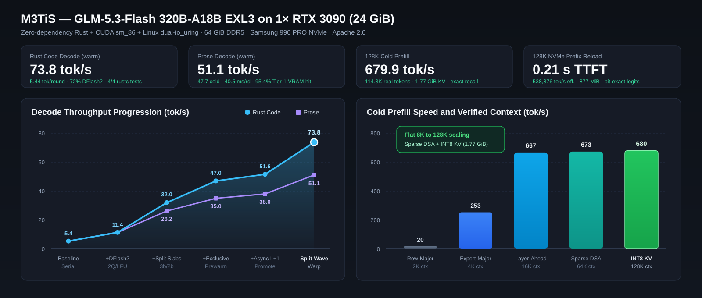

# M3TiS

M3TiS is a zero-dependency Rust, C++, and CUDA inference engine for large sparse Mixture-of-Experts language models on single-GPU consumer workstations. It treats GPU VRAM, pinned host RAM, and raw NVMe storage (`O_DIRECT` via dual Linux `io_uring` rings) as one exclusive 3-tier expert residency pool.

On a single NVIDIA RTX 3090 (24 GiB VRAM), Intel i5-13600K, 64 GiB DDR5, and a Samsung 990 PRO NVMe drive, M3TiS runs GLM-5.3-Flash (320B total parameters, 18B active, EXL3 mixed 3-bit and 2-bit routed experts) at 73.8 tokens per second on Rust code generation, 51.1 tokens per second on prose, 679.9 tokens per second cold prefill at 128K context, and 0.21 seconds time to first token when resuming a saved 114K-token session from NVMe.



## Benchmarks

All numbers below were measured on one RTX 3090 (24 GiB, with desktop applications holding ~4.8 GiB VRAM, leaving ~18.8 GiB free), 64 GiB DDR5, and one Samsung 990 PRO NVMe SSD running GLM-5.3-Flash (`glm53_v2_3b2b.m3tis`, 81.51 GiB, 30% 3-bit hot experts and 70% 2-bit cold experts) paired with `GLM-5.3-Flash-DFlash2`.

| Workload | Configuration | Throughput | Verification |
| --- | --- | --- | --- |
| Rust code decode (512 tokens, warm) | `--preset warp`, Q4 dense, DFlash2 | **73.80 tok/s** (5.44 tok/round, 72.0% draft accept) | Generated `RingBuf<T>` compiles and passes 4/4 `rustc --test` cases |
| Rust code decode (512 tokens, cold) | `--preset warp`, Q4 dense, DFlash2 | **52.40 to 61.56 tok/s** | Same compiled Rust verification |
| Prose decode (160 tokens, warm) | `--preset warp`, Q4 dense, DFlash2 | **51.11 tok/s** (94.2% to 95.4% Tier-1 VRAM hits) | Clean prose, 40.5 ms per round |
| Prose decode (160 tokens, cold) | `--preset warp`, Q4 dense, DFlash2 | **47.72 tok/s** | Clean prose, 43.8 ms per round |
| 128K context cold prefill (114,261 tokens) | `--max-ctx 131072 --kv-int8 --prefill-batch 8192` | **679.91 tok/s** (168.05 s total, 1.77 GiB KV state) | Exact verbatim needle recall (`HYPERNOVA-ZENITH-128K`) at token 20 |
| 128K NVMe disk prefix reload (new process) | `--prefix-cache-dir`, 877.03 MiB `.m3tispfx` | **0.21 s TTFT** (538,876 tok/s effective) | Bit-exact top-5 logits and bit-exact output tokens |

## Architecture

M3TiS uses zero third-party Rust crates. The workspace contains six crates and seven kernel files.

| Path | Responsibility |
| --- | --- |
| `crates/m3tis-format` | 4K-aligned `.m3tis` container reader (`M3TISPK1` and `M3TISPK2`), zero-copy safetensors indexer, CPU FP64 EXL3 reference, and BPE tokenizer. |
| `crates/m3tis-io` | Linux `io_uring` wrapper with `O_DIRECT`, registered pinned buffers, and separate demand and prefetch rings. |
| `crates/m3tis-cuda` | CUDA driver FFI (`libcuda.so`), stream and event management, and launchers for `sm_86` cubins. |
| `crates/m3tis-cache` | Exclusive 3-tier `VRAM <- Pinned Host RAM <- NVMe` expert pool, split 3-bit and 2-bit slabs, scan-resistant 2Q/LFU eviction, resident `suh`/`svh` scale bank, layer-ahead NVMe streamer, and AVX2 CPU EXL3 engine. |
| `crates/m3tis-models` | GLM-5.3-Flash forward pass (KDA linear attention, MLA latent attention, sparse top-2048 DSA indexer, INT8 KV cache, Split-Wave async MoE), DFlash2 speculative drafter, and persistent `.m3tispfx` disk prefix cache. |
| `crates/m3tis-cli` | CLI binary (`m3tis`), OpenAI-compatible HTTP/1.1 and SSE server, benchmarks, and `pack-v2` Zipf mixed-bitwidth packer. |
| `kernels/` | Six CUDA `.cu` files (`exl3_moe.cu`, `linear_q4.cu`, `glm_ops.cu`, `dflash2.cu`, `exl3_requant.cu`, `router_remap.cu`) and one AVX2 C++ file (`exl3_cpu.cpp`). |
| `tools/` | `m3tis_pack.py` (pack EXL3 safetensors to `.m3tis` v1) and `m3tis_bundle.py` (build a self-contained ~98.5 GiB checkpoint bundle). |

### Key mechanisms

- **Exclusive 3-tier split-slab caching.** VRAM and pinned host RAM hold distinct sets of routed experts with zero cross-tier duplication, split into separate 3-bit hot slabs and 2-bit cold slabs. Resident EXL3 Hadamard scales (`suh` and `svh`) stay pinned in ~425 MiB of host RAM and mirror into ~21 MiB of VRAM.
- **Split-Wave async MoE.** Resident VRAM experts run on the compute stream while Tier-2 RAM promotions and Tier-3 NVMe misses transfer asynchronously on a separate copy stream, followed by a second wave over newly promoted experts.
- **On-GPU dense Q4 packing.** Non-routed backbone weights pack into affine Q4 (`gs=64`) on startup through a single reusable 136 MiB staging buffer, keeping the entire 320B non-routed backbone plus `lm_head` around 5.1 GiB of VRAM. `embed_tokens` stays in pinned host RAM.
- **Compact 128K context.** Per-token INT8 MLA KV caches and sparse top-2048 DeepSeek Sparse Attention (DSA) indexers fit 128K context state into 1.77 GiB of VRAM, leaving over 1,400 Tier-1 VRAM expert slots on a 24 GiB GPU.
- **Layer-ahead streaming prefill.** Expert-major prefill streams one MoE layer ahead from NVMe through a pinned ring buffer so disk I/O stays overlapped behind BF16 Tensor Core GEMMs.
- **Persistent disk prefix cache.** Prompt KV, KDA recurrent state, and DSA indexer state serialize to `.m3tispfx` files on NVMe and reload across process restarts with bit-exact logits.

## Requirements

- Linux x86_64 with `io_uring` support (kernel 5.10 or newer) and `liburing` headers (`liburing-dev` or `liburing`).
- NVIDIA GPU with Compute Capability 8.6 (RTX 3090 or Ampere workstation card) and NVIDIA CUDA Toolkit (`nvcc`) plus CUDA driver (`libcuda.so`).
- Rust toolchain (edition 2024, Rust 1.85 or newer) and a C++20 compiler (`g++` with AVX2, FMA, and F16C).
- 24 GiB GPU VRAM, 32 to 64 GiB system RAM, and an NVMe SSD for GLM-5.3-Flash.

## Build and test

Build the release binary and run the workspace test suite. Set `M3TIS_CUDA_ARCH` if you want to target a different SM architecture than `sm_86`.

```bash
cargo build --release
cargo test --workspace
```

To include the real GLM-5.3 BPE tokenizer parity test, pass `M3TIS_TEST_TOKENIZER`:

```bash
M3TIS_TEST_TOKENIZER=/path/to/tokenizer.json cargo test --workspace
```

The build produces `./target/release/m3tis`.

## Quick start

1. Download the self-contained M3TiS checkpoint bundle (or pack one locally using the next section) and the DFlash2 drafter (`incoai/GLM-5.3-Flash-DFlash2`).
2. Start the OpenAI-compatible HTTP and SSE server:

```bash
./target/release/m3tis serve /path/to/GLM-5.3-Flash-Uncensored-M3TiS-v2 \
	--preset warp \
	--drafter /path/to/GLM-5.3-Flash-DFlash2 \
	--max-ctx 131072 \
	--kv-int8 \
	--prefill-batch 8192 \
	--prefix-cache-dir /tmp/m3tis-prefix-cache \
	--host 127.0.0.1 \
	--port 8080
```

When a directory contains a single `.m3tis` file, `m3tis` discovers it automatically. You can also pass the `.m3tis` path explicitly as the second positional argument.

3. Query the server with any OpenAI-compatible client:

```bash
curl http://127.0.0.1:8080/v1/chat/completions \
	-H "Content-Type: application/json" \
	-d '{
		"model": "glm-5.3-flash",
		"messages": [{"role": "user", "content": "Write a ring buffer in Rust."}],
		"max_tokens": 512,
		"stream": true
	}'
```

Endpoints exposed by `m3tis serve`:

- `GET /health`
- `GET /v1/models`
- `POST /v1/chat/completions` (supports `stream: true` SSE and `<think>` to `reasoning_content` splitting)
- `POST /v1/completions`

## Pack and bundle checkpoints

If you start from an upstream EXL3 3.0 bpw GLM-5.3-Flash safetensors checkpoint, build a v1 pack, requantize the cold 70% Zipf tail to 2-bit on GPU, and bundle the non-routed tensors:

```bash
# 1. Pack 4K-aligned uniform 3-bit routed experts (.m3tis v1, ~107 GiB)
python3 tools/m3tis_pack.py /path/to/exl3-3bpw-ckpt glm53_v1_3b.m3tis

# 2. Optional: collect routing counts to rank hot experts
./target/release/m3tis forward-check /path/to/exl3-3bpw-ckpt glm53_v1_3b.m3tis \
	--prompt-file calibration.txt --max-tokens 256 --save-zipf zipf_hits.bin

# 3. Build mixed 3b hot / 2b cold v2 pack on GPU (~81.5 GiB)
./target/release/m3tis pack-v2 glm53_v1_3b.m3tis glm53_v2_3b2b.m3tis \
	--requant-cold-2b --zipf zipf_hits.bin --hot-frac 0.30

# 4. Build a self-contained ~98.5 GiB bundle (strips duplicate trellises, MTP, and vision)
python3 tools/m3tis_bundle.py /path/to/exl3-3bpw-ckpt glm53_v2_3b2b.m3tis \
	./GLM-5.3-Flash-Uncensored-M3TiS-v2
```

## CLI reference

```text
m3tis info <pack.m3tis>
m3tis bench-io <pack.m3tis> [--qd 24] [--gb 12] [--fixed] [--sqpoll]
m3tis bench-pool <pack.m3tis> [--ram-gib 20] [--vram-gib 4.5] [--rounds 25] [--spec 3] [--policy 2q|clock]
m3tis bench-moe <checkpoint_dir> [pack.m3tis] [--iters 50]
m3tis forward-check <checkpoint_dir> [pack.m3tis] (--tokens <csv> | --prompt <text> | --prompt-file <path>) [options]
m3tis serve <checkpoint_dir> [pack.m3tis] [--preset exact|balanced|turbo|ludicrous|warp] [--drafter <dir>] [options]
m3tis pack-v2 <hot_3b.m3tis> <out_v2.m3tis> (--cold-pack <2b.m3tis> | --requant-cold-2b) [--zipf <hits.bin>] [--hot-frac 0.30]
```

Built-in presets for `forward-check` and `serve`:

- `exact`: Bit-exact routing without residency bias or NVMe pruning.
- `balanced`: Light residency bias and strict NVMe gating for top experts.
- `turbo`: Higher NVMe mass pruning with moderate draft depth.
- `ludicrous`: Aggressive NVMe mass pruning.
- `warp`: Exclusive VRAM and RAM prewarming, confidence-gated NVMe pruning (`--nvme-prune-prob 0.65`), and 7-token DFlash2 drafting (used for the 51 to 74 tok/s benchmarks above).

## Limitations

- **Single model family.** M3TiS currently implements GLM-5.3-Flash (EXL3 MCG routed experts plus DFlash2 speculative decoding). Vision tensors are not loaded.
- **Ampere-focused kernels.** Custom PTX and Tensor Core kernels target `sm_86`. Other CUDA architectures may compile with `M3TIS_CUDA_ARCH` but have not been tuned or verified.
- **Single-request server.** `m3tis serve` processes one active request at a time without continuous multi-user batching.
- **Cold startup time.** On-GPU Q4 dense packing plus VRAM and RAM Zipf prewarming takes roughly 21 to 26 seconds at process startup before serving requests.

## License

M3TiS is licensed under the Apache License, Version 2.0. See [LICENSE](LICENSE) and [NOTICE](NOTICE).
